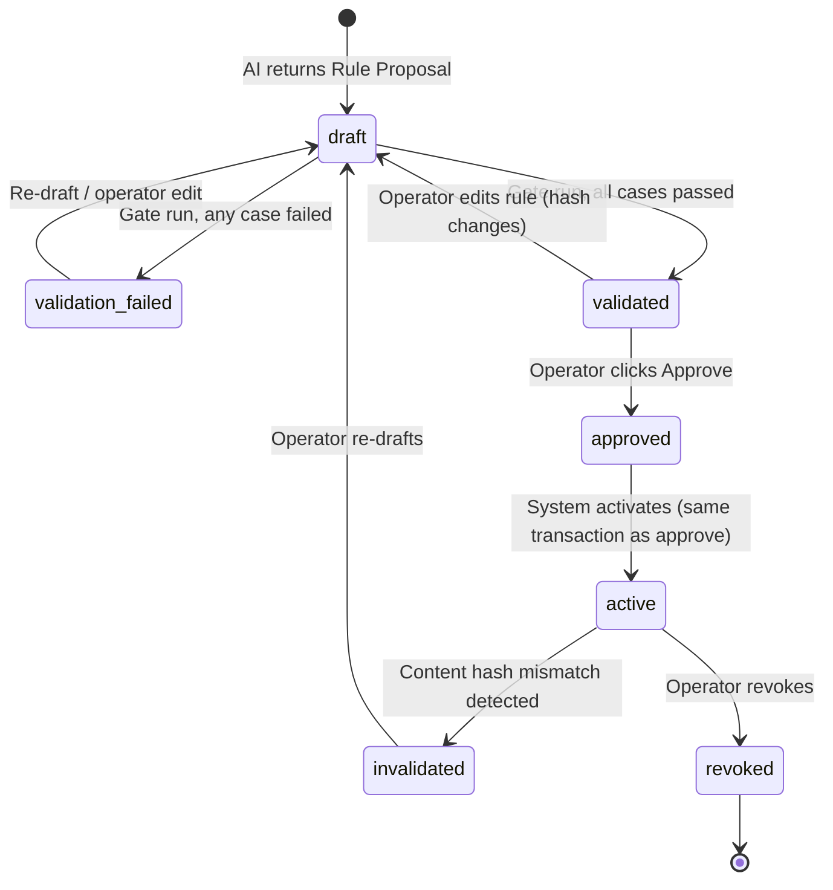
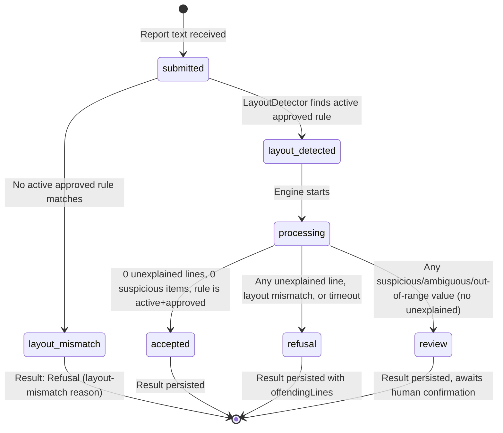

# Design Document

## Overview

Spoolgeist is a focused demonstration that proves one thesis: AI can safely draft extraction rules for legacy print-only systems, provided those rules are forced through an adversarial validation gate and an explicit human approval before they may ever run. After that, all report processing is deterministic, offline, and AI-free.

The application serves judges evaluating the Kiroween 2026 Resurrection category. It is emphatically not an enterprise system. Every design decision below is weighed against two constraints: (1) a hard competition deadline, and (2) a need to make the thesis legible and trustworthy within thirty seconds of viewing.

The design is entirely original to this repository. The prior-work research prototype (Python-based, separate repository) is used only as a test oracle per PRIOR_WORK.md; none of its architecture is reproduced here.

---

## Architecture

### Chosen Approach: Single-process TypeScript with Hono + React (Vite)

The application is a single Node.js process that serves both a JSON API and the compiled React frontend. A thin Hono server handles all API routes. The React frontend (bundled by Vite) is served as static assets from the same process. Persistence is a single JSON file on disk (the rule store); there is no database.

```
┌────────────────────────────────────────────────────┐
│                 Node.js Process                     │
│                                                     │
│  ┌──────────────┐   ┌──────────────────────────┐  │
│  │  Hono API    │   │  Static File Middleware   │  │
│  │  /api/*      │   │  / (React SPA)            │  │
│  └──────┬───────┘   └──────────────────────────┘  │
│         │                                           │
│  ┌──────▼─────────────────────────────────────┐   │
│  │            Application Core                 │   │
│  │  ┌────────────┐  ┌──────────────────────┐  │   │
│  │  │ Deterministic│ │ Rule Lifecycle        │  │   │
│  │  │ Engine      │ │ (draft→valid→approved)│  │   │
│  │  └────────────┘  └──────────────────────┘  │   │
│  │  ┌────────────┐  ┌──────────────────────┐  │   │
│  │  │ Validation  │ │ AI Provider Client    │  │   │
│  │  │ Gate        │ │ (+ Demo Mode Proxy)   │  │   │
│  │  └────────────┘  └──────────────────────┘  │   │
│  │  ┌────────────┐                             │   │
│  │  │ Rule Store  │  (JSON file, local disk)   │   │
│  │  └────────────┘                             │   │
│  └────────────────────────────────────────────┘   │
└────────────────────────────────────────────────────┘
```

**Rationale for TypeScript full-stack:** TypeScript gives a single language across the entire codebase — shared types between frontend and backend eliminate an entire class of serialization bugs and reduce the cognitive load of context-switching. The TypeScript ecosystem has mature tooling for property-based testing (fast-check), safe regex (re2js), and lightweight HTTP servers (Hono). This choice is straightforward for a demo in this scope.

**Rationale for single-process serving:** Separate frontend/backend deployments add operational surface area (CORS configuration, two deployment targets, two environment variable sets, coordinated rollouts). For a judge-facing demo with no authentication and no scaling requirement, this complexity is pure cost. A single process keeps deployment to a single `npm start` or one-click deploy.

**Rationale for Hono over Express:** Hono is lighter, has first-class TypeScript support, runs identically on Node.js and edge runtimes, and its middleware model is composable. Express works fine too — the choice is pragmatic rather than architectural.

**Rationale for JSON file store over database:** The application manages at most 3 layouts and their associated rules/approval records. A database adds a mandatory external dependency and deployment step. A single JSON file is inspectable, version-controllable, and trivially replaceable with a real database if needed. It is sufficient for the demo scope.

**Monorepo structure:** A single npm workspace with two packages — `packages/core` (engine, rule lifecycle, validation gate, shared types) and `packages/app` (Hono API + React frontend). This keeps the pure-function engine importable and testable independently from the HTTP layer.

```
spoolgeist/
├── packages/
│   ├── core/              # Pure TypeScript: engine, rules, gate, types
│   │   ├── src/
│   │   │   ├── engine.ts
│   │   │   ├── layout-detector.ts
│   │   │   ├── expression-runner.ts
│   │   │   ├── validation-gate.ts
│   │   │   ├── rule-lifecycle.ts
│   │   │   └── types.ts
│   │   └── package.json
│   └── app/               # Hono API + React frontend
│       ├── src/
│       │   ├── server.ts
│       │   ├── routes/
│       │   └── frontend/  # React SPA (Vite)
│       └── package.json
├── package.json           # Workspace root
└── vitest.workspace.ts
```

### Evaluated Alternatives

**Python + FastAPI backend, React frontend (rejected):** Python has excellent data-processing libraries, but it splits the codebase into two languages, requires a separate deployment for the backend, and loses the shared-types advantage. The prior research prototype used Python; using it here would blur the new-implementation boundary that competition integrity requires. Rejected.

**Next.js full-stack (rejected):** Next.js server components and API routes can serve as a full-stack framework. However, Next.js's build model optimises for page rendering performance — adding complexity (RSC, edge runtimes, Vercel-specific routing) that is irrelevant to this application. For a data-processing demo with a custom engine, Hono + Vite is simpler and more transparent. Rejected.

**Full AI processing with no deterministic engine (rejected):** An architecture where every report submission calls the AI provider is simpler to build but defeats the thesis entirely. The whole point is to demonstrate that the AI is used exactly once (rule drafting) and that everything after is verifiable and deterministic. Rejected on first principles.

**Structural-only rules with no expression matching (not viable):** Early consideration was to represent extraction rules as pure structural descriptions (line N, columns M–P) with no pattern matching at all. This avoids safe-execution concerns entirely. However, real print layouts have headers with variable content and measurement values that require value extraction by pattern. Structural-only rules cannot reliably handle the demo scenarios. Rejected.

---

## Components and Interfaces

### Core Package

**`ExtractionEngine`**
- Responsibility: Execute an approved ExtractionRule against a Report. Pure function. No I/O, no AI calls, no side effects.
- Inputs: `Report` (string of lines), `ApprovedRule` (typed rule with content hash).
- Outputs: `ProcessingResult` (state, extracted values with provenance, line accounting summary).
- Boundary: Throws if the rule is not in approved state. Never calls AI provider.
- Owns: line-by-line execution, expression evaluation (delegated to `ExpressionRunner`), line accounting tallying.

**`ExpressionRunner`**
- Responsibility: Compile and execute a single extraction expression safely. Wraps re2js.
- Inputs: expression string (RE2 syntax), input string.
- Outputs: match groups or null.
- Boundary: Rejects expressions at compile time if they contain constructs re2js does not support (backreferences, lookaheads). Enforces a per-match time budget via a wrapper timeout. Never throws uncaught exceptions into the engine.

**`LayoutDetector`**
- Responsibility: Given a Report, determine which (if any) active approved layout's match condition it satisfies.
- Inputs: `Report`, list of `ActiveRule[]`.
- Outputs: matched `ActiveRule` or `null`.
- Boundary: Pure function. Applies each rule's layout match expression in order. Returns the first match.

**`ValidationGate`**
- Responsibility: Run the full test suite against a RuleProposal and produce a ValidationResult.
- Inputs: `RuleProposal`, `ValidationSuite` (baseline + layout-specific cases).
- Outputs: `ValidationResult` (per-case pass/fail, observed behavior, rule content hash, limitations disclaimer).
- Boundary: Internally instantiates an `ExtractionEngine` with the proposal in a sandboxed evaluation mode (not activated). Never writes to the rule store.

**`RuleLifecycle`**
- Responsibility: Manage state transitions for a RuleProposal: draft → validated → approved → active / invalidated / revoked.
- Inputs: Lifecycle commands (`submit`, `validate`, `approve`, `revoke`, `modify`).
- Outputs: Updated `RuleRecord`.
- Boundary: Enforces all guard conditions (cannot approve without validated state, content hash must match at approval time). Writes to the rule store.

**`RuleStore`**
- Responsibility: Persist and retrieve rule records and approval records to/from the JSON file.
- Boundary: Single file. Synchronous reads, async writes. No external dependencies.

### App Package

**`ApiServer` (Hono)**
- Responsibility: Expose all application operations as JSON HTTP endpoints. Serve the compiled React SPA.
- Routes: see Data Flow section.
- Boundary: Validates all incoming request bodies. Returns typed JSON responses. Does not contain business logic — delegates to core.

**`AiProviderClient`**
- Responsibility: Call the configured AI provider with a prompt containing the unknown-layout report and produce a raw rule proposal text.
- Boundary: Returns raw text; never trusted. Demo mode returns a pre-recorded response without making a network call.

**React Frontend**
- Responsibility: Provide the judge-facing UI. All state derived from API responses. No local business logic.
- Boundary: Communicates only with the app's own API. No direct AI provider calls from the browser.

---

## Data Models

### `Report`

```typescript
interface Report {
  id: string;               // UUID, assigned on submission
  submittedAt: string;      // ISO 8601 timestamp
  content: string;          // Raw text of the print job
  lines: string[];          // content split by line (derived, immutable)
  sourceLabel: string;      // Human-readable label, e.g. "Demo: CBC Panel v1"
}
```

### `ExtractionRule`

The central data structure. Stored as JSON, strongly typed.

```typescript
interface ExtractionRule {
  ruleId: string;             // UUID
  layoutId: string;           // e.g. "cbc-panel-v1"
  layoutName: string;         // Human-readable
  layoutVersion: number;

  // Layout match condition: an RE2 expression tested against the full report
  // text (joined). A report matches this layout if this expression finds a match.
  layoutMatchExpression: string;  // RE2 syntax

  // Per-line classification definitions.
  // Applied in order; first match wins for each line.
  lineClassifications: LineClassification[];

  // After all lineClassifications are applied, any line not matched
  // is Unexplained Content.
  plausibilityChecks: PlausibilityCheck[];

  metadata: {
    createdAt: string;        // ISO 8601
    draftedBy: "ai" | "operator";
    aiModel?: string;         // e.g. "claude-3-5-sonnet-20241022"
  };
}

type LineClassification =
  | { kind: "extract"; measurementId: string; measurementName: string;
      lineMatchExpression: string;   // RE2: matches the whole line
      valueExpression: string;       // RE2 named capture group "value"
      unitExpression?: string;       // RE2 named capture group "unit"
      plausibleRange?: { min: number; max: number };
    }
  | { kind: "ignore"; reason: string; lineMatchExpression: string; }
  | { kind: "header"; lineMatchExpression: string; }
  | { kind: "footer"; lineMatchExpression: string; };

interface PlausibilityCheck {
  checkId: string;
  description: string;
  // Expression evaluated against two named measurement IDs.
  // e.g. check that haematocrit ≈ 3 × haemoglobin.
  kind: "ratio" | "range" | "mutual-consistency";
  parameters: Record<string, unknown>;
}
```

### `ContentHash`

A SHA-256 hex digest of the JSON-serialised `ExtractionRule` with keys sorted deterministically. Used to bind an Approval to the exact rule version it covers.

```typescript
function computeRuleHash(rule: ExtractionRule): string {
  const canonical = JSON.stringify(rule, Object.keys(rule).sort());
  return crypto.createHash("sha256").update(canonical).digest("hex");
}
```

### `RuleRecord`

```typescript
type RuleStatus =
  | "draft"
  | "validation-failed"
  | "validated"
  | "approved"
  | "active"
  | "invalidated"
  | "revoked";

interface RuleRecord {
  rule: ExtractionRule;
  contentHash: string;      // Recomputed and checked on every write
  status: RuleStatus;
  validationRunId?: string;
  approvalRecord?: ApprovalRecord;
  invalidationReason?: string;
  history: RuleEvent[];     // Append-only audit log
}

interface ApprovalRecord {
  approvedAt: string;       // ISO 8601
  ruleContentHash: string;  // Must equal RuleRecord.contentHash at activation
  validationRunId: string;  // Links to ValidationResult
  scopeStatement: string;   // "Synthetic data only. Not clinically validated."
}

interface RuleEvent {
  eventId: string;
  eventType: "created" | "submitted-for-validation" | "validation-passed" |
             "validation-failed" | "approved" | "activated" | "invalidated" |
             "revoked" | "modified";
  timestamp: string;
  detail: string;
}
```

### `ValidationResult`

```typescript
interface ValidationResult {
  runId: string;
  ruleContentHash: string;      // The rule version this applies to
  ranAt: string;                // ISO 8601
  passed: boolean;              // All cases passed
  cases: ValidationCase[];
  limitations: string;          // Honest statement of what this gate cannot prove
}

interface ValidationCase {
  caseId: string;
  caseLabel: string;
  property: string;             // e.g. "refusal of unexplained content"
  kind: "baseline" | "layout-specific";
  reportContent: string;        // The test report used
  passed: boolean;
  expectedState: ProcessingState;
  observedState: ProcessingState;
  observedResult: ProcessingResult;
  failureDetail?: string;
}
```

### `ProcessingResult`

```typescript
type ProcessingState = "accepted" | "refusal" | "review" | "layout-mismatch";

interface ProcessingResult {
  reportId: string;
  processedAt: string;
  state: ProcessingState;
  ruleId?: string;
  ruleContentHash?: string;
  aiCallCount: 0;             // Always 0; literal type ensures no AI call
  extractedValues: ExtractedValue[];
  lineAccountingSummary: LineAccountingSummary;
  offendingLines?: OffendingLine[];
  suspiciousContent?: SuspiciousItem[];
  resolutionHint?: string;
  timeoutOccurred?: boolean;
}

interface ExtractedValue {
  measurementId: string;
  measurementName: string;
  rawValue: string;
  unit?: string;
  numericValue?: number;
  plausibilityStatus: "ok" | "out-of-range" | "ambiguous";
  provenance: Provenance;
}

interface Provenance {
  lineNumber: number;         // 0-indexed
  lineContent: string;        // Exact text of the source line
  matchedExpression: string;  // The lineMatchExpression used
  captureGroup: string;       // The named capture group "value"
  startOffset: number;
  endOffset: number;
}

interface LineAccountingSummary {
  totalLines: number;
  extractedLines: number;
  ignoredLines: number;
  unexplainedLines: number;
  lineBreakdown: LineEntry[];
}

interface LineEntry {
  lineNumber: number;
  content: string;
  classification: "extracted" | "ignored" | "unexplained";
  classificationId?: string;  // Which LineClassification matched
}

interface OffendingLine {
  lineNumber: number;
  content: string;
  reason: "unexplained" | "tampered-value" | "out-of-range" | "layout-mismatch" | "ambiguous";
  detail: string;
}

interface SuspiciousItem {
  lineNumber: number;
  content: string;
  suspicionKind: string;
  detail: string;
}
```

---

## Safe Expression Execution

This is Requirement 11 — safety-critical. AI-drafted patterns must not cause ReDoS (catastrophic backtracking), hang the server, or compromise the application. The evaluation below is based on actual npm package research.

### Candidates Evaluated

**Option A: `re2` (npm package, C++ native binding via node-gyp)**

The `re2` package (published by uhop, also known as node-re2) provides Node.js bindings for Google's C++ RE2 library. It offers a drop-in `RegExp`-compatible API, is actively maintained (published 21 days ago at time of research), and guarantees linear-time matching via automata theory.

Limitations and risks identified:
- It is a native C++ addon compiled with node-gyp. Deployment to PaaS environments (Railway, Render) requires either prebuilt binaries or a compilation toolchain at deploy time. Native addons have caused documented breakages when Node.js ABI versions change between build host and runtime (e.g., Vercel serverless function ABI mismatches). The latest re2 version requires `Node ^22.22.2 || ^24.15.0 || >=26`, which is a specific version constraint that must be pinned carefully.
- RE2 does not support backreferences or lookahead/lookbehind assertions. This is by design — these constructs require exponential backtracking. For print-layout extraction (line matching, named captures of values and units), this restriction is acceptable.
- Native addons are not usable in browser-based tests without mocking.

**Option B: `re2js` (pure JavaScript RE2 port)**

`re2js` is a pure JavaScript port of Go's `regexp` package (itself a RE2 implementation). Published recently, actively maintained (updated April 2026 per search results). It achieves full architectural parity with Go's RE2 implementation.

Advantages:
- Zero native dependencies — no node-gyp, no prebuilt binaries, no ABI mismatch risk.
- Works identically in Node.js and browser environments (useful for running engine tests in Vitest without mocking).
- Pure JS avoids the N-API bridge overhead that can slow down native addons for frequent small-match operations. (Per a GitHub issue on the re2js project, pure JS sometimes outperforms the native binding for many operations due to eliminated cross-boundary serialisation costs.)
- Same RE2 syntax guarantees: no backreferences, no lookaheads, linear-time matching.

Limitations:
- Pure JS will be slower than the C++ native binding for very large inputs or very frequent matching. For this application (≤12 measurements, ≤3 layouts, synthetic reports of hundreds of lines), this performance difference is irrelevant.
- The API is not a drop-in `RegExp` replacement; it has its own compile/match interface that must be wrapped.

**Option C: Structural-only patterns (no expression engine)**

Represent extraction rules as pure positional definitions: "line 5, columns 20–35". No pattern matching, no ReDoS risk. This is the safest execution model possible.

Limitation: Inadequate for the demo scope. Real print layouts have variable-width fields, measurement names embedded in lines, units appended to values, and variable line counts when panels have more or fewer results. Pure positional rules cannot handle these without heroic field-width assumptions. Rejected as insufficient.

**Option D: Sandboxed `eval` / `vm.runInNewContext`**

Run AI-drafted patterns inside a Node.js `vm.runInNewContext` sandbox with a timeout and no access to global scope.

This does not solve ReDoS — JavaScript's native `RegExp` engine is still the underlying engine, still subject to catastrophic backtracking. A timeout catches a hanging match after the fact but cannot prevent CPU saturation during the hang. Rejected.

### Decision: `re2js` (pure JavaScript RE2 port)

**Re2js is recommended.** Its linear-time guarantee comes from the same algorithmic foundation as the C++ RE2 library. For this demo's scope (small synthetic reports, infrequent matching), the performance cost of pure JS is negligible. The elimination of native addon deployment friction is a concrete, measurable benefit that reduces risk during the competition demo.

**Deployment reliability trumps marginal performance for a demo.**

The `ExpressionRunner` wraps re2js as follows:

```typescript
import { RE2JS } from "re2js";

export function compileExpression(pattern: string): CompiledExpression {
  // Will throw RE2JS.PatternSyntaxException if pattern is invalid
  // (e.g., contains backreferences or unsupported syntax)
  const compiled = RE2JS.compile(pattern);
  return { pattern, compiled };
}

export function runExpression(
  expr: CompiledExpression,
  input: string,
  timeoutMs: number = 500
): RegExpMatchArray | null {
  // Wrap in a synchronous timeout guard.
  // For re2js (linear-time), this is a belt-and-suspenders measure —
  // RE2 cannot pathologically backtrack, but we still bound execution
  // as a defence against unexpectedly large inputs.
  const start = performance.now();
  const matcher = expr.compiled.matcher(input);
  if (!matcher.find()) return null;
  const elapsed = performance.now() - start;
  if (elapsed > timeoutMs) {
    throw new ExpressionTimeoutError(`Expression exceeded ${timeoutMs}ms`);
  }
  return extractNamedGroups(matcher);
}
```

**RE2 syntax restrictions for rule authors / AI prompt:** The AI prompt for rule drafting must explicitly state that backreferences (`\1`) and lookahead/lookbehind assertions (`(?=...)`, `(?!...)`, `(?<=...)`, `(?<!...)`) are not permitted, and that named capture groups (`(?P<name>...)`) must use the RE2/Python-style syntax that re2js accepts.

---

## Validation Architecture

### Test Suite Structure

The validation gate executes two categories of test cases:

```typescript
interface ValidationSuite {
  baselineCases: ValidationCase[];      // Fixed, hand-authored, layout-agnostic
  layoutSpecificCases: ValidationCase[]; // Derived for the layout being onboarded
}
```

**Baseline cases (defined at build time, in `packages/core/src/validation/baseline-suite.ts`):**
These are fixed and version-controlled. They test fundamental engine properties regardless of layout:

| Case ID | Property | Report content |
|---------|----------|---------------|
| `BL-01` | Refusal of pure unexplained content | Report with no matching layout |
| `BL-02` | Refusal when any line is unexplained | Valid report with one extra injected line |
| `BL-03` | Refusal of tampered numeric value | Valid report with a value replaced by `@@@@` |
| `BL-04` | Determinism | Same report processed twice; results must be byte-identical |
| `BL-05` | Line accounting completeness | Every line classified; total equals line count |
| `BL-06` | Refusal of wrong layout | A report from a different known layout |
| `BL-07` | Timeout recovery | Report with an injected expression designed to be very long |
| `BL-08` | No AI calls during processing | AI call counter equals zero after any deterministic processing |

**Layout-specific cases (generated during onboarding, based on the submitted unknown report):**
When a new layout is being onboarded, the gate generates additional cases by applying mutations to the submitted report:

- One clean copy of the original report (should be accepted).
- One copy with a randomly selected line removed (should produce unexplained content in remaining context, or layout mismatch).
- One copy with a measurement value replaced by a non-numeric string.
- One copy with a measurement value outside the plausible range defined in the rule.

These cases exercise the new rule specifically. They are stored alongside the ValidationResult and are specific to the rule version they were generated for.

### Gate Execution

```
ValidationGate.run(proposal, suite):
  1. For each case in suite.baselineCases ++ suite.layoutSpecificCases:
     a. Instantiate ExtractionEngine with proposal (in "proposal evaluation" mode — not activated in rule store)
     b. Run engine on case.reportContent
     c. Compare result.state to case.expectedState
     d. Record pass/fail, observed state, observed result
  2. Compute passed = all cases passed
  3. Return ValidationResult {
       runId, ruleContentHash, ranAt, passed, cases,
       limitations: LIMITATIONS_DISCLAIMER
     }
```

The `LIMITATIONS_DISCLAIMER` is a fixed string, displayed verbatim in the UI:

> "This gate checks the rule against a fixed suite of synthetic test cases. It does not prove the rule is correct for all possible reports. It does not test against real patient data. It does not detect all possible rule authoring errors. A passed gate is a necessary condition for activation, not a proof of safety."

### Result Recording and Versioning

A `ValidationResult` is permanently stored keyed by `runId`. The `RuleRecord` stores the `runId` of its latest validation run. When the rule content changes (operator edit or AI re-draft), the `validationRunId` on the record is cleared, invalidating the prior validation evidence. A re-run is required.

### Activation Guard

The gate enforces the "both gates required" condition from Requirement 5.6 at the `RuleLifecycle` level:

```
canApprove(record):
  return record.status === "validated"
      && record.validationRunId !== null
      && ValidationStore.get(record.validationRunId).passed === true
      && ValidationStore.get(record.validationRunId).ruleContentHash === record.contentHash
```

The final check (`ruleContentHash` match) ensures that if the rule was modified between validation and the approval attempt, the stale validation evidence cannot be used to approve the modified rule.

---

## Approval Lifecycle

### State Machine



### Transition Triggers and Guards

| Transition | Trigger | Guard | Data recorded |
|------------|---------|-------|---------------|
| `→ draft` | AI response received or re-draft | None | `rule`, `contentHash`, `draftedBy`, `metadata` |
| `draft → validation-failed` | Gate run, `passed=false` | None | `validationRunId`, failing case details |
| `draft → validated` | Gate run, `passed=true` | None | `validationRunId` |
| `validated → draft` | Any rule field edited | Hash recomputed, old hash stored | `invalidationReason: "content-modified"` |
| `validated → approved` | Operator clicks Approve | `canApprove()` must return true | `approvalRecord` with hash, runId, timestamp |
| `approved → active` | Same transaction as approve | None | Activation timestamp |
| `active → invalidated` | Content hash mismatch | `rule.hash ≠ approvalRecord.ruleContentHash` | `invalidationReason` |
| `active → revoked` | Operator clicks Revoke | None | Revocation timestamp |

### Content Hash Verification at Approval

Before recording the `ApprovalRecord`, the system recomputes `computeRuleHash(record.rule)` and compares it to both `record.contentHash` (the stored hash) and `validationResult.ruleContentHash`. If either comparison fails, the approval is rejected with a descriptive error.

### Modification Detection

The rule store recomputes the content hash on every read. If the stored `contentHash` does not match the freshly computed hash of `record.rule`, the record is immediately transitioned to `invalidated` state with reason `"storage-integrity-error"`. This handles both accidental and deliberate tampering with the stored JSON file.

---

## Processing Lifecycle

### State Machine for a Report



### State Transition Logic (Engine pseudocode)

```
process(report, store):
  1. rules = store.getActiveApprovedRules()
  2. matched = LayoutDetector.detect(report, rules)
  3. if matched == null:
       return { state: "refusal", reason: "layout-mismatch", aiCallCount: 0, ... }
  4. if matched.contentHash ≠ matched.approvalRecord.ruleContentHash:
       throw IntegrityError (should have been caught at store read)
  5. lineResults = []
  6. for each line in report.lines:
       result = applyClassifications(line, matched.rule.lineClassifications)
       if result == null: lineResults.push({ classification: "unexplained" })
       else: lineResults.push(result)
  7. unexplained = lineResults.filter(r => r.classification === "unexplained")
  8. if unexplained.length > 0:
       return { state: "refusal", reason: "unexplained-content", offendingLines: unexplained, aiCallCount: 0, ... }
  9. suspiciousItems = runPlausibilityChecks(lineResults, matched.rule.plausibilityChecks)
  10. if suspiciousItems.length > 0:
        return { state: "review", suspiciousContent: suspiciousItems, aiCallCount: 0, ... }
  11. return { state: "accepted", extractedValues: ..., aiCallCount: 0, ... }
```

### Line Accounting Representation

The `lineAccountingSummary` is derived from `lineResults`. It is always present in every `ProcessingResult`, regardless of state. The UI uses it to render the "ghost guide" — a line-by-line view of the report with each line colour-coded by classification.

The invariant `totalLines === extractedLines + ignoredLines + unexplainedLines` must hold for every result. This invariant is verified by the engine before returning.

---

## Error Handling

| Failure mode | Detection | Response | User-visible |
|-------------|-----------|----------|-------------|
| **Unexplained content** | Line accounting: `unexplained.length > 0` | Refusal state | Offending lines shown with line numbers |
| **Suspicious / out-of-range value** | Plausibility check fails | Review state | Suspicious items listed, resolution hint shown |
| **Layout mismatch** | `LayoutDetector` returns null | Refusal state | "No supported layout matched this report" |
| **Validation gate failure** | Any `ValidationCase.passed === false` | Rule stays in `draft` state; activation blocked | Failing case shown with expected vs. actual |
| **Approval invalidation (hash mismatch)** | Hash recomputed on read differs from stored | Rule moved to `invalidated`, engine rejects it | Invalidation reason and timestamp shown |
| **Expression compile error** | `re2js.compile()` throws `PatternSyntaxException` | Rule Proposal marked invalid; gate rejects | Error message with offending expression highlighted |
| **Expression timeout** | `performance.now()` delta exceeds `timeoutMs` | Refusal state with `timeoutOccurred: true` | "Processing exceeded time limit" with rule reference |
| **AI provider unavailable** | HTTP error or timeout on provider call | Demo mode fallback activated automatically | Banner: "Using pre-recorded AI response (demo mode)" |
| **Demo mode** | `AI_DEMO_MODE=true` env var | Pre-recorded response served | Persistent banner in onboarding flow |
| **Storage integrity error** | Hash mismatch on rule store read | Rule moved to `invalidated` | "Rule integrity check failed — re-validation required" |

All error responses include enough information for the operator to understand what failed, why, and what action is required. No silent failure. No partial extraction presented as complete.

---

## Security Boundaries

### What Executes Where

```
Browser (React SPA)
  → Sends report text, receives ProcessingResult JSON
  → Never executes extraction expressions
  → Never calls AI provider directly
  → Never has access to rule content hash validation logic

API Server (Hono)
  → Validates request bodies (Zod schema validation on all inputs)
  → Delegates to core functions; holds no business logic itself
  → AI Provider calls originate from server, not browser

Core Engine
  → Executes RE2 expressions via re2js (pure JS, no eval, no native addon)
  → Expressions are compiled before execution (compile-time rejection of unsafe syntax)
  → Expressions run against report content only (no access to filesystem, network, or globals)
  → Engine is a pure function: it cannot modify the rule store

AI Provider Boundary
  → Input to AI: the unknown-layout report text, a fixed system prompt defining RE2 syntax constraints, the target output format (JSON ExtractionRule schema)
  → Output from AI: raw text, treated as untrusted
  → Parsing: the raw text is parsed against the ExtractionRule JSON schema (Zod); any parse failure rejects the proposal entirely
  → The parsed proposal is NEVER activated until it passes the validation gate and receives an explicit approval
```

### What Can Be Injected

The AI provider's output is the main injection surface. Mitigations:
1. The output is parsed against a strict Zod schema; unexpected fields are stripped.
2. All `lineMatchExpression` and `valueExpression` strings are compiled by re2js before any execution; invalid RE2 syntax is rejected at compile time.
3. RE2's grammar prevents backreferences and lookaheads, which are the primary ReDoS vectors.
4. Expressions run against report text, which is user-submitted text. Report text is never interpreted as code.
5. The `lineClassifications` array length is bounded (max 50 entries) to prevent resource exhaustion from pathologically large rule proposals.

There is no user authentication, no session management, and no sensitive data. The application handles only synthetic data throughout.

---

## Demo / Replay Strategy

### Demonstration Mode

Demonstration Mode activates when the environment variable `AI_DEMO_MODE=true` is set. In this mode, the `AiProviderClient` returns a pre-recorded response without making any outbound network call.

### Pre-recorded Responses

Stored as JSON files in `packages/app/src/demo-recordings/`:

```
demo-recordings/
├── layout-cbc-panel.json          # Recorded proposal for CBC Panel layout
├── layout-metabolic-panel.json    # Recorded proposal for Basic Metabolic Panel
└── layout-lipid-panel.json        # Recorded proposal for Lipid Panel
```

Each file contains the exact AI response text that would have been returned, plus metadata:

```typescript
interface DemoRecording {
  layoutId: string;
  capturedAt: string;
  aiModel: string;
  promptHash: string;    // SHA-256 of the prompt used to capture this response
  responseText: string;  // The raw AI response (unparsed rule proposal text)
}
```

### Pre-built Demo Scenarios

The seeded rule store (loaded at server start in demo mode) includes:

| Scenario | Pre-built | Description |
|----------|-----------|-------------|
| **Clean accepted** | ✓ CBC Panel layout approved; "clean CBC report" demo report | Shows full accepted state with provenance |
| **Suspicious refusal** | ✓ CBC Panel approved; "tampered CBC report" demo report | Shows refusal state with offending lines |
| **Out-of-range review** | ✓ CBC Panel approved; "borderline CBC report" demo report | Shows review state with suspicious items |
| **Unknown layout onboarding** | ✓ Lipid Panel layout unknown; demo recording ready | Shows full gate + approval flow |
| **Repeat processing** | ✓ Both CBC and BMP layouts approved | Shows zero-AI repeat processing |

### Demo Mode UI Signal

A persistent banner appears at the top of every page when `isDemoMode === true` in the API response:

> "Demo mode: AI responses are pre-recorded. No live AI calls are made."

This satisfies Requirement 4.4's honesty obligation. The banner is visually distinct (not dismissible).

### Seeding

At server startup, if `AI_DEMO_MODE=true` and the rule store is empty, the server loads a pre-seeded rule store from `packages/app/src/demo-recordings/seeded-store.json`. This ensures the hosted demo is immediately usable without manual onboarding steps for the CBC and BMP layouts. The Lipid Panel layout is left unboarded to demonstrate the onboarding flow.

---

## Deployment Strategy

### Chosen Approach: Single Node.js process on Railway

The application is deployed as a single Node.js process to [Railway](https://railway.com). Railway runs Docker containers from a `Dockerfile` in the repository root; it does not use serverless functions, so native addon ABI mismatch issues that affect Vercel functions do not apply. (This is moot given the re2js decision, but informs the platform choice more broadly.)

**Why Railway over Vercel:** Vercel's main value proposition is Next.js optimisation and edge functions. For a single-process Hono server with no server-side rendering framework, Railway is a better fit: it runs a persistent container, supports `npm start` with no framework-specific configuration, and has a free tier adequate for a demo.

**Why not fly.io:** Fly.io is excellent but requires Docker familiarity and more configuration. Railway's GitHub integration is simpler for a deadline-constrained project.

**Why not self-contained executable:** A self-contained binary (pkg, nexe) reduces deployment to a single file download, which could appeal for a judge demo. However, it complicates the build pipeline and embedding assets. A Railway deploy is simpler and more reproducible.

**Deployment configuration:**

```
Dockerfile:
  FROM node:22-alpine
  WORKDIR /app
  COPY package*.json ./
  RUN npm ci
  COPY . .
  RUN npm run build
  EXPOSE 3000
  CMD ["node", "packages/app/dist/server.js"]

Environment variables on Railway:
  AI_DEMO_MODE=true
  PORT=3000
  RULE_STORE_PATH=/data/rules.json   (Railway persistent volume)
```

The build produces a single compiled `server.js` with the React SPA assets inlined as a static directory.

---

## UX Structure

### View Inventory

**`/` — Landing**
Shows the problem statement and the three-step model (AI drafts once → gate → deterministic forever). Includes a "Try a demo report" section with 3–4 clickable synthetic reports that immediately navigate to the processing view. Contains a prominent synthetic-data disclaimer. No login, no navigation required to understand the application's purpose.

**`/process` — Report Submission + Processing Result**
A text area for pasting or receiving a demo report. On submission, displays the full `ProcessingResult`. The result view has three clearly visually distinct modes:
- **Accepted:** Green indicator. Extracted values table with per-value provenance links. Line accounting summary. Zero AI calls badge.
- **Refusal:** Red indicator. Offending lines highlighted in the Line Accounting view. Reason and resolution hint. Suspicious content preserved and shown.
- **Review:** Amber indicator. Suspicious items listed. Human confirmation prompt. No values displayed as "verified".

The Line Accounting view is always visible: a list of every report line, colour-coded as extracted / ignored / unexplained. This is the "every line accounted for" proof.

**`/onboard` — Unknown Layout Onboarding**
Reached when a submitted report does not match any active layout. Shows the unrecognised report. Operator can click "Draft extraction rule with AI". Shows AI call happening (or demo mode banner). Transitions to the Validation Gate view when the proposal is returned.

**`/validate/:ruleId` — Validation Gate**
Shows the Rule Proposal text (read-only), the validation test suite, and the results of running the gate. Per-case pass/fail with the report content used, expected vs. actual state, and observed behavior. The gate's limitations statement is shown below the results. If all cases pass, an "Approve" button appears. If any case fails, the failing case is highlighted and the Approve button is absent.

**`/approve/:ruleId` — Pre-Approval Review**
Shown when the operator clicks Approve on the Validation Gate view. Presents: rule definition, validation evidence (linked run), all warnings, synthetic-data scope statement. Single "Confirm Approval" button. After approval, navigates to the active rules view.

**`/rules` — Rule Registry**
Lists all rule records with their current status (draft / validated / approved+active / invalidated / revoked). Links to validation evidence and approval records. Revoke button on active rules.

### Navigation Model

```
Landing (/)
  ↓ [Submit demo report]
  Process View (/process)
    ↓ [Layout not recognised]
    Onboard (/onboard)
      ↓ [AI drafts rule]
      Validate (/validate/:ruleId)
        ↓ [All cases pass → Approve button]
        Pre-Approval Review (/approve/:ruleId)
          ↓ [Confirm Approval]
          Back to Process View (rule now active)
  
Landing (/)
  ↓ [Nav: Rules]
  Rule Registry (/rules)
    ↓ [View validation evidence]
    Validate View (read-only past run)
```

### Core Concept Communication

The design must make three things visually unambiguous:
1. **Accepted vs. Refused vs. Review are distinct states** — not just different text, visually different layouts.
2. **Every line is accounted for** — the line accounting view is not a summary buried in a tab; it is the primary display alongside extracted values.
3. **Zero AI calls during processing** — displayed as a badge or counter in the processing result, not hidden in documentation.

The "ghost guide" concept (overlaying the original report text with extraction annotations) is a useful device for making provenance legible: when a judge clicks on an extracted measurement value, the corresponding source line in the report view is highlighted. This is implemented as a bidirectional link between the extracted values table and the line accounting view, not as a separate overlay component.

---

## Correctness Properties

*A property is a characteristic or behavior that should hold true across all valid executions of a system — essentially, a formal statement about what the system should do. Properties serve as the bridge between human-readable specifications and machine-verifiable correctness guarantees.*

### Property 1: Master Safety Invariant

*For any* (Report, ExtractionRule) pair, the Deterministic Engine SHALL produce an Accepted state if and only if both conditions hold simultaneously: the rule's content hash matches its approval record's hash, and every line in the report is classified as extracted or ignored (zero unexplained lines) and no suspicious items are flagged.

**Validates: Requirements 9.1, 2.3, 3.1, 3.4, 3.6**

### Property 2: Determinism / Pure Function

*For any* (Report, ApprovedRule) pair, the Deterministic Engine returns byte-identical results on every invocation. The result is a pure function of its inputs with no dependence on time, network, random state, or AI provider.

**Validates: Requirements 2.5, 7.3, 9.7**

### Property 3: Line Accounting Completeness

*For any* Report processed under any rule (regardless of outcome), the sum of extracted lines, ignored lines, and unexplained lines in the LineAccountingSummary equals the total line count of the report.

**Validates: Requirements 2.2**

### Property 4: Provenance Completeness

*For any* ProcessingResult with a non-empty extractedValues array, every ExtractedValue has a non-null Provenance entry containing a valid lineNumber (within the report's line range), non-empty lineContent matching the report line, and non-empty matchedExpression.

**Validates: Requirements 2.6, 9.10**

### Property 5: Non-Accepted State Data Completeness

*For any* ProcessingResult in Refusal or Review state, the result contains at least one entry in offendingLines (for Refusal) or suspiciousContent (for Review), a non-empty reason string, and a non-empty resolutionHint string.

**Validates: Requirements 3.2, 3.5, 9.11**

### Property 6: Approval Guard

*For any* RuleRecord, the approve() operation succeeds if and only if: the record's status is "validated", the stored contentHash matches the freshly computed hash of the rule, and the validationRunId's ValidationResult.passed is true and its ruleContentHash matches the record's contentHash.

**Validates: Requirements 5.6, 6.7, 4.6, 9.4, 9.5**

### Property 7: Content Hash Invalidation

*For any* approved RuleRecord, mutating any field of the rule (any change that alters the canonical JSON) produces a new content hash that does not match approvalRecord.ruleContentHash, which causes the engine to reject the rule and the lifecycle to transition the record to "invalidated" state.

**Validates: Requirements 6.4, 6.5, 9.6**

### Property 8: Validation Evidence Traceability

*For any* ValidationResult, the ruleContentHash field is non-empty and equals the computeRuleHash() of the RuleProposal that the gate was run against.

**Validates: Requirements 5.8, 6.2**

### Property 9: AI-Call-Count Invariant

*For any* invocation of the Deterministic Engine (processing a Report under an approved rule), the aiCallCount field in the returned ProcessingResult equals exactly 0.

**Validates: Requirements 2.1, 2.4, 4.5, 7.1, 7.2, 9.8**

### Property 10: Rule Proposal Trust Boundary

*For any* response from the AI provider (or demo mode recording), the returned RuleProposal always has status "draft" and is never in "active" or "approved" state. The proposal cannot be used by the engine until it has passed the full validation gate and received an explicit approval.

**Validates: Requirements 4.2, 4.3, 9.9**

### Property 11: Expression Safety (Compile-Time Rejection)

*For any* expression string passed to `compileExpression()` that contains constructs not supported by RE2 (backreferences, lookaheads, lookbehinds), the function throws a `PatternSyntaxException` and no `CompiledExpression` is returned. The rule containing such an expression is rejected at validation gate time.

**Validates: Requirements 11.1, 11.3**

### Property 12: Timeout Enforcement

*For any* (expression, input) pair processed by the engine, if execution time exceeds `timeoutMs`, the engine returns a Refusal state with `timeoutOccurred: true` rather than continuing execution or returning a partial result.

**Validates: Requirements 11.2**

---

## Testing Strategy

### Framework: Vitest + fast-check

**Unit and property tests:** [Vitest](https://vitest.dev/) — fast, ESM-native, first-class TypeScript, Jest-compatible API. No separate configuration for the monorepo; `vitest.workspace.ts` at the root references both packages.

**Property-based testing:** [fast-check](https://fast-check.dev/) with the [`@fast-check/vitest`](https://www.npmjs.com/package/@fast-check/vitest) integration. fast-check is the standard PBT library for the TypeScript ecosystem, actively maintained, runner-agnostic, and well-suited to generating typed arbitrary values for the data models above.

Minimum 100 iterations per property test (fast-check default is 100). Property tests are tagged with comments in the format: `Feature: golden-path-application, Property {N}: {property_text}`.

### Test Organisation

```
packages/core/src/__tests__/
├── engine.property.test.ts    # Properties 1-4, 9
├── lifecycle.property.test.ts # Properties 6-8, 10
├── expression.property.test.ts # Properties 11-12
├── engine.unit.test.ts        # Example-based: specific accepted/refused/review scenarios
├── gate.integration.test.ts   # Validation gate: suite execution, evidence recording
└── fixtures/
    └── reports/               # Fixed synthetic report strings for unit tests
```

### Property Test Implementation Notes

Each correctness property maps to exactly one property test:

**Property 1 (Master Safety Invariant):** Generate arbitrary `Report` and `ApprovedRule` combinations. Verify: if `lineAccounting.unexplainedLines > 0` or `suspiciousContent.length > 0` or `rule.contentHash ≠ rule.approvalRecord.ruleContentHash`, then `result.state ≠ "accepted"`. Contrapositive: `result.state === "accepted"` implies all three conditions hold.

**Property 2 (Determinism):** Generate arbitrary `(report, approvedRule)` pairs. Run engine twice. Assert `JSON.stringify(result1) === JSON.stringify(result2)`.

**Property 3 (Line Accounting Completeness):** Generate arbitrary reports. Assert `summary.extractedLines + summary.ignoredLines + summary.unexplainedLines === report.lines.length`.

**Property 4 (Provenance Completeness):** Generate arbitrary reports that produce extracted values. Assert every `extractedValue.provenance.lineNumber` is in range `[0, report.lines.length)` and `extractedValue.provenance.lineContent === report.lines[provenance.lineNumber]`.

**Property 11 (Expression Safety):** Generate arbitrary strings containing backreferences (`\1`, `\2`...) and lookahead syntax (`(?=`, `(?!`, `(?<=`, `(?<!`). Assert `compileExpression()` always throws `PatternSyntaxException`.

### Unit Tests (Example-Based)

Cover:
- Clean accepted CBC Panel report → Accepted state
- Same report with one injected line → Refusal state, that line in offendingLines
- Report with measurement value replaced → Refusal state, reason "tampered-value"
- Report matching wrong layout → Refusal state, reason "layout-mismatch"
- Report with out-of-range measurement → Review state, suspicious item present
- Approved rule modified → engine rejects with integrity error
- Validation gate run on clean proposal → all baseline cases pass
- Validation gate run on proposal with bad expression → expression error case fails

### Integration Tests

Cover the full onboarding flow end-to-end (HTTP layer):
- POST `/api/reports` with unknown layout → 200 with `state: "layout-mismatch"` and onboarding prompt
- POST `/api/rules/draft` → 200 with draft rule record
- POST `/api/rules/:id/validate` → 200 with ValidationResult
- POST `/api/rules/:id/approve` → 200 with ApprovalRecord
- POST `/api/reports` with now-known layout → 200 with `state: "accepted"` and `aiCallCount: 0`

### What Is Not Tested with PBT

- UI rendering — snapshot / example tests
- Demo mode fallback — example test (verify pre-recorded response is returned)
- Approval workflow UI — example/integration tests
- Performance benchmarks — not in scope for the demo

---

## Stretch Goals (Optional Extensions)

These are clearly marked as stretch goals per Requirement 8.4. They are **not** in the core path. If core-workflow delivery (Requirements 1–7) is at any risk, these are cut first.

### FHIR DiagnosticReport Export

If implemented, it is an endpoint that accepts a `ProcessingResult` in Accepted state and returns a FHIR R4 `DiagnosticReport` resource. The resource is marked with:
- `meta.tag`: `[{ system: "http://spoolgeist.demo/data-quality", code: "synthetic" }]`
- `status: "preliminary"` (not "final" — synthetic data must not appear clinically finalized)

Mapping: `ExtractedValue[]` → `DiagnosticReport.result[]` (each as an `Observation` reference or inline component).

This is only implemented if Requirements 1–7 are demonstrably complete. The endpoint is `/api/reports/:id/fhir-export`.

### Patient-Friendly Report View

A simplified HTML view of the extracted values, formatted as a "plain English lab result summary". This is a frontend-only rendering concern — no new data model is needed. It is only implemented if core delivery is not at risk.

---

## Notes and Deferred Decisions

- **Zod schema version for rule validation:** Zod v3 is the current stable version and is the choice for all schema validation in the app.
- **Report storage:** Reports are not persisted to disk in the initial implementation; they exist only in memory for the duration of the request. This simplifies the data model. If audit logging is needed later, an append-only log file can be added.
- **Concurrent requests:** The rule store uses a simple file lock (write-then-read with an in-memory mutex) sufficient for a demo with no concurrent users. Not suitable for production.
- **AI provider choice:** OpenAI (`gpt-4o`) or Anthropic (`claude-3-5-sonnet`) are both viable. The `AiProviderClient` interface is provider-agnostic; the concrete implementation is chosen by environment variable. Demonstration Mode makes this moot for the hosted demo.
